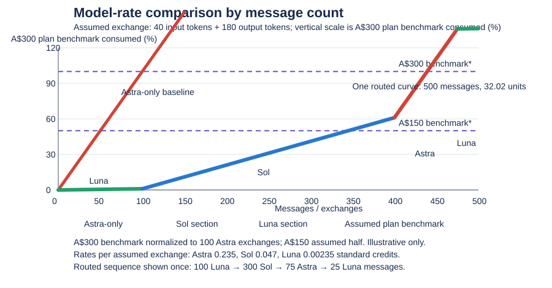

<div align="center">

```text
┌──────────────────────────────────────────────────────────────────────┐
│  MODEL ROUTER                                          CODEX / SKILL │
└──────────────────────────────────────────────────────────────────────┘

       request ──► classify ──► route ──► execute ──► verify
                       │           │
                       └── escalate on evidence ────┘
```

# Model Router

**A practical Codex skill for choosing the lightest model and reasoning level that can reliably finish the job.**

[Install](#install) · [Routing](#routing) · [How switching works](#how-switching-works)

</div>

Model choice is only one part of efficient work. Context transfer, tool calls, retries and verification all count. Model Router keeps those costs in view and escalates when the evidence says it should.

## What it does

- Routes bounded lookups and extraction to a fast, economical model.
- Uses a balanced workhorse for everyday coding and analysis.
- Saves frontier reasoning for difficult diagnosis and consequential tradeoffs.
- Keeps delegation focused, limits retry loops and verifies the result.
- Gives a concise explanation when a supported model switch is made or requested.

## Default and category routes

GPT-6.1 Sol at low reasoning is the default for mixed or uncategorised work. The router changes the route when a task has a clear specialist shape, and can use different routes for separate stages of one job.

| Category | Default route | Escalate when |
|---|---|---|
| Instagram Reels and short-form video | GPT-6.1 Sol · low for concept and script; media tools for production | Claims need careful checking or edit review finds issues |
| Software development | GPT-6.1 Sol · low for bounded fixes; medium for multi-file work | A focused fix fails or design tradeoffs are substantial |
| Research and current information | GPT-6.1 Luna · low for lookup; GPT-6.1 Sol · medium for synthesis | Sources conflict or conclusions carry meaningful consequences |
| Writing and communications | GPT-6.1 Luna · low for short drafts; GPT-6.1 Sol · low for longer work | The subject is sensitive or argument is complex |
| Images and design | GPT-6.1 Terra · low for visual review; image tools for creation and editing | Visual requirements are ambiguous or review finds mismatches |
| Audio and voice | GPT-6.1 Luna · low for transcription; audio tools for production | Attribution, timing or meaning is unclear |
| Spreadsheets and data | GPT-6.1 Luna · low for extraction; GPT-6.1 Sol · medium for reconciliation | Inputs conflict or calculations affect consequential decisions |
| Documents and presentations | GPT-6.1 Sol · low for routine drafting; format-specific tools | Substantive review is needed or layout checks fail |
| Browser and app operations | GPT-6.1 Terra · low for visual workflows; GPT-6.1 Luna · low for simple status checks | UI state is ambiguous; stop for access blockers |
| Monitoring and automation | GPT-6.1 Luna · low for bounded checks; scripts for repetition | An exception needs diagnosis or an action has significant impact |

These are starting defaults to evaluate, not measured savings guarantees or fixed account entitlements. Use the models available in the runtime, and keep tool choice, source quality and verification appropriate to the task.

## Estimated messages by model

The line chart keeps the existing comparison format and adds message counts. Each exchange is assumed to contain a short one- or two-sentence prompt (40 input tokens) and a few-paragraph response (180 output tokens). It uses published standard credit rates to estimate model-weighted burn.



Under these assumptions, one exchange costs about 0.235 standard credits on Astra, 0.047 on Sol and 0.00235 on Luna. A normalized budget equal to 100 Astra exchanges would therefore cover about 500 same-sized Sol exchanges or 10,000 Luna exchanges. The chart's routed curve assumes a mix of 10% Astra, 70% Sol and 20% Luna, yielding about 413 exchanges for the same normalized budget.

The A$150 and A$300 horizontal lines are illustrative thresholds, with the A$150 line assumed to be half the A$300 allowance. OpenAI does not publish those Australian tiers' Codex allowances, and subscription usage is not a direct conversion from standard credit rates. The account check on 10 November 2026 reported Pro's weekly allowance fully used, but not the message count that consumed it.

These message estimates exclude prior conversation context, tool results, reasoning tokens, images and retries. Real exchanges can consume much more, and the assumed prompt and response sizes are planning values rather than measured averages. Treat the curves as a model comparison, not a forecast of when your plan will run out. [Standard model credit rates and usage guidance](https://learn.chatgpt.com/docs/pricing#token-rates) · [Usage dashboard](https://chatgpt.com/codex/settings/usage).

## How switching works

A skill runs after a turn has started, so it cannot change the model that is already answering. When Codex exposes a supported model override for a later turn, the router can request a continuation in the same chat. It gives one short notice, for example:

> We changed the model to GPT-6 Luna (low reasoning). Why: this task only needs a straightforward lookup.

A queued request is not proof that the new model actually ran. The skill distinguishes a confirmed switch from a request that was merely accepted. If no supported control is available, it recommends the model picker and carries on with the work.

## Install

Clone this repository, then copy the skill files into your Codex skills directory:

```sh
git clone https://github.com/lockej2005/model-router-skill.git
mkdir -p ~/.codex/skills/model-router
cp model-router-skill/SKILL.md ~/.codex/skills/model-router/
cp -R model-router-skill/agents ~/.codex/skills/model-router/
```

Invoke it explicitly with `$model-router`. To make it a default, add a short instruction to your global `~/.codex/AGENTS.md` telling Codex to apply the skill to each task. Automatic skill discovery and global instructions guide behavior; neither is a pre-request interceptor.

## Design constraints

The router does not promise a fixed savings percentage. It avoids routing overhead on tiny tasks, uses one worker for a coherent delegated job, and escalates after a meaningful failed check. Login problems and missing permissions are treated as access blockers, not reasons to spend tokens on a stronger model.

It does not change subscriptions, purchase credits, consume resets or silently rewrite global model settings.

## Repository layout

```text
.
├── SKILL.md
├── README.md
└── agents/
    └── openai.yaml
```

## License

No license has been added yet. Until a license is chosen, reuse and redistribution remain subject to the repository owner's rights.
