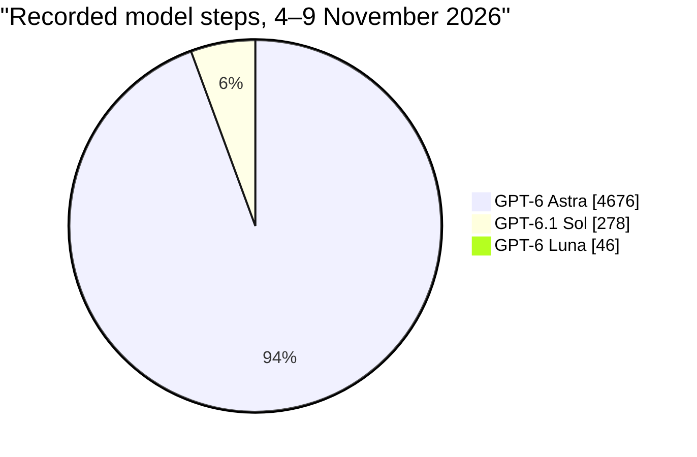
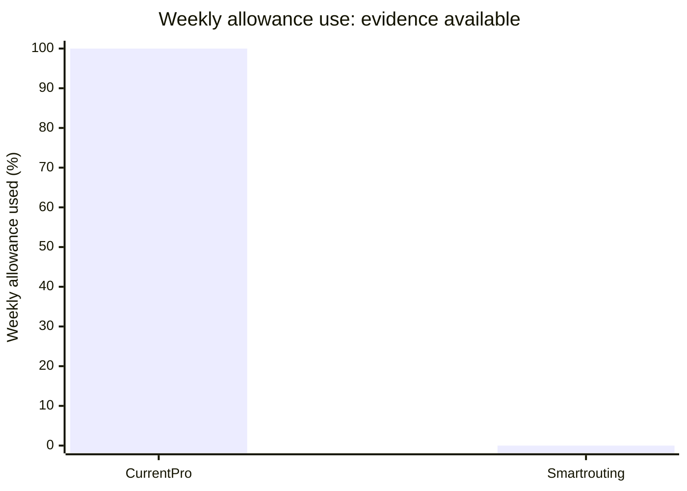

<div align="center">

```text
┌──────────────────────────────────────────────────────────────────────┐
│  MODEL ROUTER                                          CODEX / SKILL │
└──────────────────────────────────────────────────────────────────────┘

       request ──► classify ──► route ──► execute ──► verify
                       │           │
                       └── escalate on evidence ────┘
```

# Model Router

**A practical Codex skill for choosing the lightest model and reasoning level that can reliably finish the job.**

[Install](#install) · [Routing](#routing) · [How switching works](#how-switching-works)

</div>

Model choice is only one part of efficient work. Context transfer, tool calls, retries and verification all count. Model Router keeps those costs in view and escalates when the evidence says it should.

## What it does

- Routes bounded lookups and extraction to a fast, economical model.
- Uses a balanced workhorse for everyday coding and analysis.
- Saves frontier reasoning for difficult diagnosis and consequential tradeoffs.
- Keeps delegation focused, limits retry loops and verifies the result.
- Gives a concise explanation when a supported model switch is made or requested.

## Default and category routes

GPT-6.1 Sol at low reasoning is the default for mixed or uncategorised work. The router changes the route when a task has a clear specialist shape, and can use different routes for separate stages of one job.

| Category | Default route | Escalate when |
|---|---|---|
| Instagram Reels and short-form video | GPT-6.1 Sol · low for concept and script; media tools for production | Claims need careful checking or edit review finds issues |
| Software development | GPT-6.1 Sol · low for bounded fixes; medium for multi-file work | A focused fix fails or design tradeoffs are substantial |
| Research and current information | GPT-6.1 Luna · low for lookup; GPT-6.1 Sol · medium for synthesis | Sources conflict or conclusions carry meaningful consequences |
| Writing and communications | GPT-6.1 Luna · low for short drafts; GPT-6.1 Sol · low for longer work | The subject is sensitive or argument is complex |
| Images and design | GPT-6.1 Terra · low for visual review; image tools for creation and editing | Visual requirements are ambiguous or review finds mismatches |
| Audio and voice | GPT-6.1 Luna · low for transcription; audio tools for production | Attribution, timing or meaning is unclear |
| Spreadsheets and data | GPT-6.1 Luna · low for extraction; GPT-6.1 Sol · medium for reconciliation | Inputs conflict or calculations affect consequential decisions |
| Documents and presentations | GPT-6.1 Sol · low for routine drafting; format-specific tools | Substantive review is needed or layout checks fail |
| Browser and app operations | GPT-6.1 Terra · low for visual workflows; GPT-6.1 Luna · low for simple status checks | UI state is ambiguous; stop for access blockers |
| Monitoring and automation | GPT-6.1 Luna · low for bounded checks; scripts for repetition | An exception needs diagnosis or an action has significant impact |

These are starting defaults to evaluate, not measured savings guarantees or fixed account entitlements. Use the models available in the runtime, and keep tool choice, source quality and verification appropriate to the task.

## Observed model mix and weekly usage

Local Codex session records from 4–9 November 2026 show the following model mix. The mix is counted by recorded model steps, not by subscription allowance consumed.



That is approximately 93.5% Astra, 5.6% Sol and 0.9% Luna across 5,000 recorded steps. A step is not necessarily one user message, and session records do not cover activity on every device or account surface.

The account usage check on 10 November 2026 reported the current Pro weekly allowance at 100%. The available record gives that endpoint but not daily allowance readings, so a time-series line would invent intermediate values. The chart below shows the verified weekly endpoint alongside the explicitly unmeasured router comparison.



The first bar is the verified Pro reading. The zero-height second bar is a placeholder for missing measurement, not zero consumption: smart-routing usage has not yet been measured. The account interface does not expose allowance percentages for the A$150 and A$300 tiers, and plan price alone cannot establish their limits. OpenAI says usage varies with model, task size, context, tools and caching. [Pricing and usage guidance](https://learn.chatgpt.com/docs/pricing#what-are-the-usage-limits-for-my-plan) · [Usage dashboard](https://chatgpt.com/codex/settings/usage).

For a fair downgrade comparison, record the allowance percentage at consistent times over comparable weeks, alongside the plan tier, model mix, completed work and any extra credits. Then compare actual weekly curves for the Astra-heavy baseline and smart routing. Add A$150 or A$300 threshold lines only when the account shows those tiers' actual limits.

## How switching works

A skill runs after a turn has started, so it cannot change the model that is already answering. When Codex exposes a supported model override for a later turn, the router can request a continuation in the same chat. It gives one short notice, for example:

> We changed the model to GPT-6 Luna (low reasoning). Why: this task only needs a straightforward lookup.

A queued request is not proof that the new model actually ran. The skill distinguishes a confirmed switch from a request that was merely accepted. If no supported control is available, it recommends the model picker and carries on with the work.

## Install

Clone this repository, then copy the skill files into your Codex skills directory:

```sh
git clone https://github.com/lockej2005/model-router-skill.git
mkdir -p ~/.codex/skills/model-router
cp model-router-skill/SKILL.md ~/.codex/skills/model-router/
cp -R model-router-skill/agents ~/.codex/skills/model-router/
```

Invoke it explicitly with `$model-router`. To make it a default, add a short instruction to your global `~/.codex/AGENTS.md` telling Codex to apply the skill to each task. Automatic skill discovery and global instructions guide behavior; neither is a pre-request interceptor.

## Design constraints

The router does not promise a fixed savings percentage. It avoids routing overhead on tiny tasks, uses one worker for a coherent delegated job, and escalates after a meaningful failed check. Login problems and missing permissions are treated as access blockers, not reasons to spend tokens on a stronger model.

It does not change subscriptions, purchase credits, consume resets or silently rewrite global model settings.

## Repository layout

```text
.
├── SKILL.md
├── README.md
└── agents/
    └── openai.yaml
```

## License

No license has been added yet. Until a license is chosen, reuse and redistribution remain subject to the repository owner's rights.
